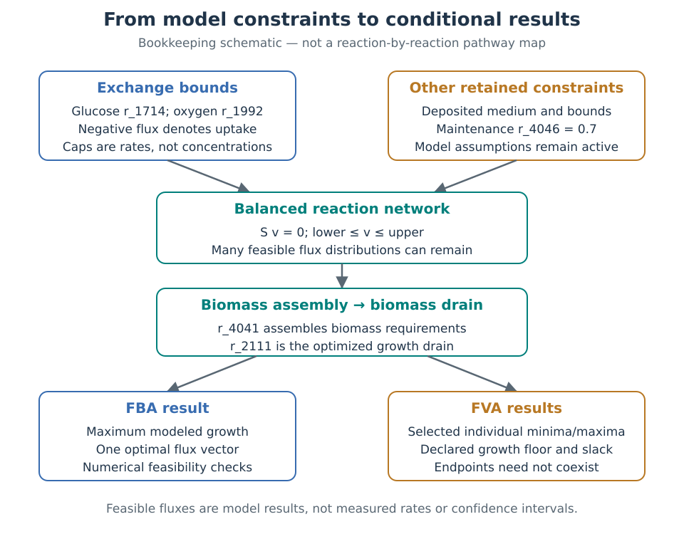
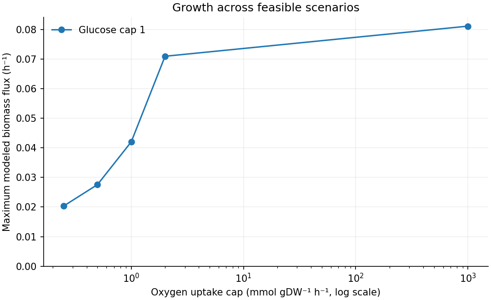
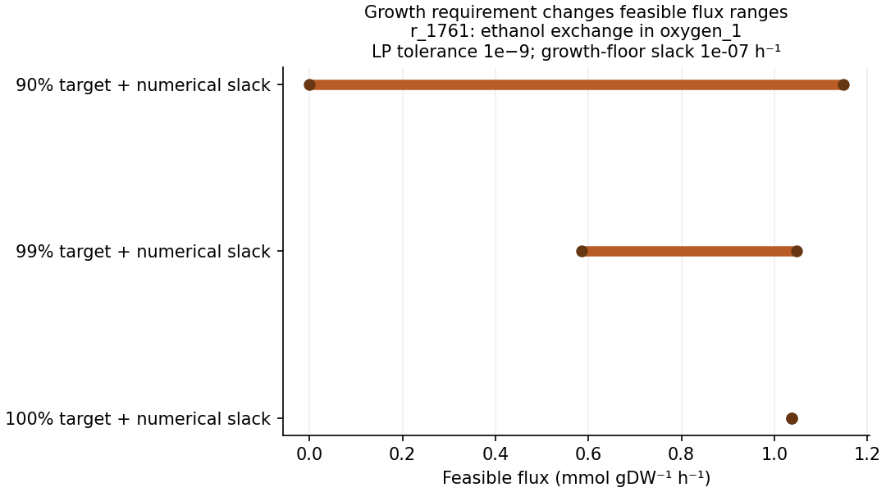

# Yeast flux workbench

Run six scenarios in a published yeast metabolism model to see how an oxygen-uptake limit changes the highest feasible growth rate. Then inspect the range of reaction rates, or fluxes, compatible with that growth. Two flux patterns can support the same growth rate.

## Why this project

This supports [From biological measurements to better experiments](https://github.com/TheThunda01/TheThunda01/blob/main/PROJECT_GUIDE.md) by examining how constraints shape model conclusions and why one numerical solution may leave alternative explanations open.

Figure 1 follows the calculation from nutrient uptake to the biomass drain that the solver maximizes. Every feasible solution must balance the modeled metabolites and respect the bounds on each reaction. The [biology guide](docs/biology-and-concepts.md) explains what that bookkeeping represents.



**Figure 1. Constraints define a set of model possibilities.** This is a conceptual map of the implemented calculation, not a reaction-by-reaction metabolic pathway. The reaction identifiers come from the [pinned model](data/README.md); the [methods](docs/methods.md) define signs, growth floors and numerical slack. The [figure builder](tools/build_documentation_figures.py) and [source manifest](docs/figures/figure-manifest.json) make the diagram reproducible.

## What it does

- Loads the official **yeast-GEM v9.1.1** snapshot: 2,748 metabolites, 4,105 reactions and 1,143 genes. These are this snapshot's counts, not the counts of the earlier publication version.
- Maximizes its biomass objective under five positive oxygen-uptake caps, with a fixed glucose cap. A sixth, no-glucose case is an explicit infeasibility diagnostic.
- Calculates 36 selected flux-variability ranges across two scenarios and three growth requirements. It records the requested requirement and a small numerical slack separately.
- Checks mass balance, bounds and primal–dual agreement; independently checks saved flux vectors and re-solves optima/ranges using another HiGHS algorithm.
- Exports a Cytoscape reaction/metabolite neighborhood with exact stoichiometry, one saved feasible flux vector and explicitly requested versus missing FVA attributes.

Flux balance analysis (FBA) finds an optimum; flux variability analysis (FVA) finds each selected reaction’s permitted minimum and maximum at a specified growth requirement. Primal–dual agreement compares the optimization problem with its mathematical bounding counterpart.

The source is [Zhang et al.’s (2024) community-curated Yeast9](https://doi.org/10.1038/s44320-024-00060-7), pinned to [release v9.1.1](https://github.com/SysBioChalmers/yeast-GEM/releases/tag/v9.1.1). No gene engineering, new organism model, or experimental validation is claimed.

## Quick start

From the repository root, use Python 3.12:

```sh
python -m venv .venv
source .venv/bin/activate
python -m pip install -r requirements.txt
python run.py --output-dir .reproduction
python verify_results.py --results-dir .reproduction
python -m unittest discover -s tests -v
```

On Windows, activate the environment with `.venv\Scripts\activate`.

The 530 kB model and source license are included; the analysis needs no network or commercial solver. The included `scenarios.json` sets the six default scenarios. Pass a different file with `--config PATH` to both the runner and verifier. Open the generated `report.md` to see how many scenarios reached an optimum, which cases were infeasible and the plots requested for that run.

The commands above write to and verify `.reproduction/`, keeping the checked-in example intact. Choose another directory with `--output-dir PATH` and pass the same path to the verifier's `--results-dir`; omitting `--output-dir` replaces files in `results/`. `--no-plots` skips figures. The Markdown report uses UTF-8 to preserve scientific units across system text encodings.

Git attributes preserve the exact source-file bytes and LF line endings needed by the fingerprint checks, including on Windows. Do not re-save the bundled model, medium or license files to change their encoding or line endings.

## Example results

With the glucose uptake cap held at 1, lowering the oxygen uptake cap from 1000 to 1 reduces the modeled growth optimum from **0.0811 to 0.0420 h⁻¹**. The caps are in millimoles per gram of dry cell weight per hour. Compare the rows `aerobic_reference` and `oxygen_1` in the [scenario table](results/scenarios.csv).

**Table 1. Where to inspect each part of the result.**

| Output | What to inspect |
| --- | --- |
| [Report](results/report.md) and [scenario table](results/scenarios.csv) | Six statuses and optimal-growth values; an infeasible case has no substituted growth value. |
| [Flux ranges](results/fva.csv) | Minimum/maximum fluxes, growth requirements, numerical slack and artificial-bound flags. |
| [Full diagnostics](results/analysis.json) | Every FBA/FVA solve's status, residuals, bound violations and duality gap. |
| [Saved flux vectors](results/fba_fluxes.npz) | Complete feasible FBA vectors, read with NumPy `allow_pickle=False`. |
| [Run manifest](results/manifest.json) | Source/config/code fingerprints, runtime and solver settings, output hashes. |

Figures 2 and 3 answer different questions: how the optimum changes under oxygen caps, and how much freedom remains for one selected exchange flux.



**Figure 2. Modeled growth under declared oxygen-uptake caps.** Source: [scenario results](results/scenarios.csv). Glucose and the other deposited constraints are retained. These are optimization results, not measured growth responses.



**Figure 3. Conditional ethanol-exchange ranges.** Source: [saved FVA results](results/fva.csv). The growth fractions and numerical slack define different feasible sets; the intervals are neither confidence intervals nor samples from a probability distribution.

Each plotted interval describes one reaction's feasible range. Endpoints from different reactions need not occur in the same solution.

The [Cytoscape inspection guide](docs/cytoscape-inspection.md) adds an editable network of 18 reactions and 34 metabolites around the six FVA reactions. Its 54 edges come directly from the pinned stoichiometric matrix. It labels missing ranges explicitly and keeps forward reaction direction separate from the sign of a saved flux.

## Practical use and limitations

Use this fixed aerobic model to learn sparse optimization, check scenario assumptions, and examine alternative optimal solutions. The analysis retains all deposited bounds except the two explicitly changed exchange lower bounds. The fixed maintenance requirement helps explain why the no-glucose case is infeasible.

Conventional FBA does not include all enzyme-capacity, kinetic, regulatory or dynamic constraints. Standard FVA may permit internal cycles or reach arbitrary numerical bounds.

Lowering oxygen alone does not create a complete anaerobic model. These results also do not validate the Crabtree effect: aerobic fermentation under particular carbon conditions. See the [practical-use contract](docs/practical-use.md) before adapting a scenario.

## Documentation

The [21 October 2026 maintenance and scientific review](docs/review-2026-10-21.md) records the latest checks and their limits. Earlier review records remain available below.

| Guide | Purpose |
| --- | --- |
| [Context](docs/project-context.md) | Background, question and themes. |
| [Biology and concepts](docs/biology-and-concepts.md) | Yeast metabolism, biomass, constraints and feasible ranges. |
| [Methods](docs/methods.md) | Equations, signs, slack, diagnostics and verification. |
| [References](docs/references.md) | Sources and their actual roles. |
| [Data provenance](data/README.md) / [manifest](data/provenance.json) | Version, source files, checksums and reuse. |
| [Practical use](docs/practical-use.md) | Input/output and failure contracts, worked run and next improvements. |
| [Literature review](docs/literature-review.md) / [search record](docs/search-log.json) | Bounded review and source-to-code decisions. |

Definitions and interpretation: [glossary](docs/glossary.md), [assumptions](docs/assumptions.md), [reference audit](docs/reference-audit.json) and [dated review](docs/review-2026-10-20.md).

## Development and reuse

Twenty tests cover known toy optima/ranges, unsigned objective handling, infeasible/unbounded problems, input mistakes, source corruption, residuals, full-model verification, stoichiometric network exports, and native-import attribute and endpoint checks. Continuous integration (CI) runs tests, the analysis and the result checker. This is AI-assisted original analysis code, with explicit literature and upstream attribution.

Original code is [MIT licensed](LICENSE). The model and its medium definition retain [CC BY 4.0 attribution](data/UPSTREAM_LICENSE.md); the MIT license does not replace those terms.

Rebuild Figure 1 with `python tools/build_documentation_figures.py`. It writes only `docs/figures/` and does not modify the model or saved optimization results.
