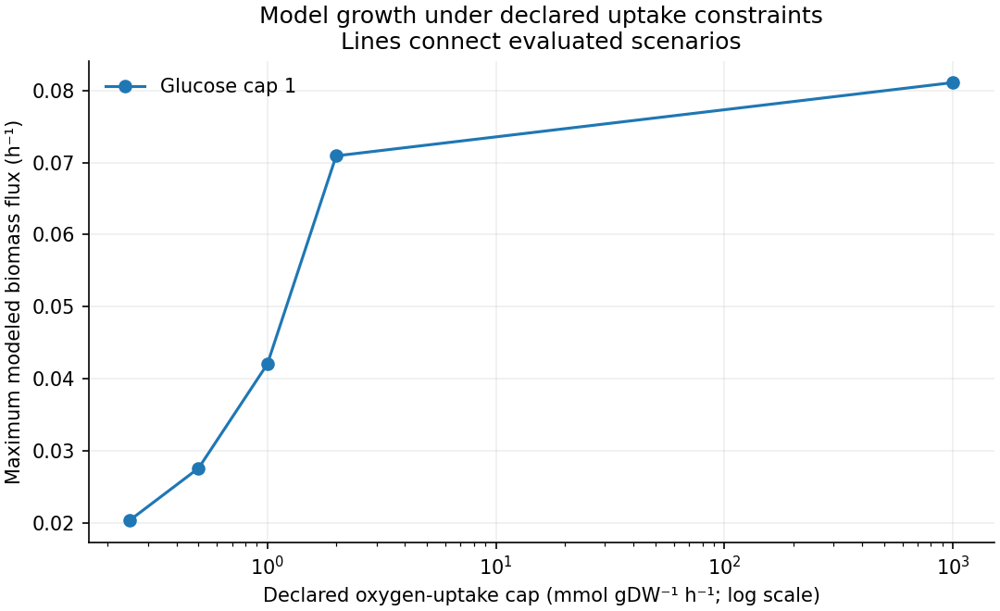
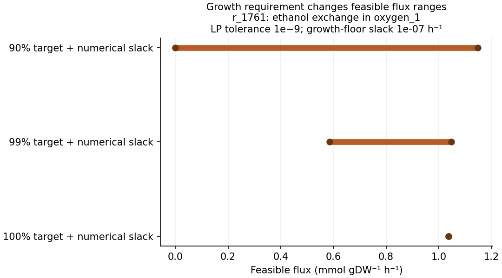

# Yeast flux workbench

Which metabolic conclusions follow from a model's constraints, and which depend on the particular solution a solver returns? This project explores that question in a curated yeast network. A flux is a reaction rate; linear programming finds the best value of a linear objective subject to constraints. Sparse storage keeps only the nonzero entries of the reaction matrix.

## Why this project

Genome-scale models describe many reactions across an organism’s metabolism. They make biological assumptions concrete: reactions conserve modeled metabolites, nutrients enter through bounded exchanges, and a chosen objective defines an optimum. Those assumptions deserve as much attention as the final growth number. This workbench follows them from a pinned model to a reproducible report. Start with the [project context](docs/project-context.md) and [biology guide](docs/biology-and-concepts.md).

Figure 1 follows the bookkeeping from those assumptions to the reported results. It separates the biomass-assembly reaction from the drain that the optimizer maximizes.


**Figure 1. Constraints define a set of model possibilities.** This is a conceptual map of the implemented calculation, not a reaction-by-reaction metabolic pathway. The reaction identifiers come from the [pinned model](data/README.md); the [methods](docs/methods.md) define signs, growth floors and numerical slack. The [figure builder](tools/build_documentation_figures.py) and [source manifest](docs/figures/figure-manifest.json) make the diagram reproducible.

## What it does

- Loads the official **yeast-GEM v9.1.1** snapshot: 2,748 metabolites, 4,105 reactions and 1,143 genes. These are this snapshot's counts, not the counts of the earlier publication version.
- Maximizes its biomass objective under five positive oxygen-uptake caps, with a fixed glucose cap. A sixth, no-glucose case is an explicit infeasibility diagnostic.
- Calculates 36 selected flux-variability ranges across two scenarios and three growth requirements. It records the requested requirement and a small numerical slack separately.
- Checks mass balance, bounds and primal–dual agreement; independently checks saved flux vectors and re-solves optima/ranges using another HiGHS algorithm.

Flux balance analysis (FBA) finds an optimum; flux variability analysis (FVA) finds each selected reaction’s permitted minimum and maximum at a specified growth requirement. Primal–dual agreement compares the optimization problem with its mathematical bounding counterpart.

The source is [Zhang et al.’s (2024) community-curated Yeast9](https://doi.org/10.1038/s44320-024-00060-7), pinned to [release v9.1.1](https://github.com/SysBioChalmers/yeast-GEM/releases/tag/v9.1.1). No gene engineering, new organism model, or experimental validation is claimed.

## Quick start

From the repository root, use Python 3.12:

```sh
python -m pip install -r requirements.txt
python run.py
python verify_results.py
python -m unittest discover -s tests -v
```

The 530 kB model and source license are included; the analysis needs no network or commercial solver. To keep a new run separate, use `python run.py --output-dir my_results` and `python verify_results.py --results-dir my_results`. `--no-plots` skips figures. The included `scenarios.json` is the full scenario contract.

## Example results

The aerobic reference produces a modeled biomass flux of about **0.0811 h⁻¹**. Exchange caps use mmol gDW⁻¹ h⁻¹: millimoles per gram dry cell weight per hour. Limiting the oxygen-uptake cap to 1 while retaining the glucose cap of 1 gives about **0.0420 h⁻¹**. These are solutions to the specified optimization problem, not measured growth rates.

**Table 1. Where to inspect each part of the result.**

Table 1 links the files behind Figures 2 and 3 and the associated numerical checks.

| Output | What to inspect |
| --- | --- |
| [Report](results/report.md) and [scenario table](results/scenarios.csv) | Six statuses and optimal-growth values; an infeasible case has no substituted growth value. |
| [Flux ranges](results/fva.csv) | Minimum/maximum fluxes, growth requirements, numerical slack and artificial-bound flags. |
| [Full diagnostics](results/analysis.json) | Every FBA/FVA solve's status, residuals, bound violations and duality gap. |
| [Saved flux vectors](results/fba_fluxes.npz) | Complete feasible FBA vectors, read with NumPy `allow_pickle=False`. |
| [Run manifest](results/manifest.json) | Source/config/code fingerprints, runtime and solver settings, output hashes. |

Figures 2 and 3 answer different questions: how the optimum changes under oxygen caps, and how much freedom remains for one selected exchange flux.



**Figure 2. Modeled growth under declared oxygen-uptake caps.** Source: [scenario results](results/scenarios.csv). Glucose and the other deposited constraints are retained. These are optimization results, not measured growth responses.



**Figure 3. Conditional ethanol-exchange ranges.** Source: [saved FVA results](results/fva.csv). The growth fractions and numerical slack define different feasible sets; the intervals are neither confidence intervals nor samples from a probability distribution.

The plotted intervals are individual feasible ranges. Endpoints from different reactions need not occur in the same solution. Their width is not a confidence interval.

## Practical use and limitations

This is an educational analysis of a fixed aerobic model, useful for learning sparse optimization, checking scenario assumptions, and examining alternative optimal solutions. It retains all deposited bounds except the two explicitly changed exchange lower bounds. The fixed maintenance requirement helps explain why the no-glucose case is infeasible.

Conventional FBA does not include all enzyme-capacity, kinetic, regulatory or dynamic constraints. Lowering oxygen alone does not create a complete anaerobic model, and these results do not validate the Crabtree effect, aerobic fermentation under particular carbon conditions. Standard FVA may permit internal cycles or reach arbitrary numerical bounds. See the [practical-use contract](docs/practical-use.md) before adapting a scenario.

## Documentation

| Guide | Purpose |
| --- | --- |
| [Context](docs/project-context.md) | Background, question and themes. |
| [Biology and concepts](docs/biology-and-concepts.md) | Yeast metabolism, biomass, constraints and feasible ranges. |
| [Methods](docs/methods.md) | Equations, signs, slack, diagnostics and verification. |
| [References](docs/references.md) | Sources and their actual roles. |
| [Data provenance](data/README.md) / [manifest](data/provenance.json) | Version, source files, checksums and reuse. |
| [Practical use](docs/practical-use.md) | Input/output and failure contracts, worked run and next improvements. |
| [Literature review](docs/literature-review.md) / [search record](docs/search-log.json) | Bounded review and source-to-code decisions. |

Definitions and interpretation: [glossary](docs/glossary.md), [assumptions](docs/assumptions.md), [reference audit](docs/reference-audit.json) and [dated review](docs/review-2026-10-20.md).

## Development and reuse

Twelve tests cover known toy optima/ranges, unsigned objective handling, infeasible/unbounded problems, input mistakes, source corruption, residuals and the full-model verification. Continuous integration (CI) runs tests, the analysis and the result checker. This is AI-assisted original analysis code, with explicit literature and upstream attribution.

Original code is [MIT licensed](LICENSE). The model and its medium definition retain [CC BY 4.0 attribution](data/UPSTREAM_LICENSE.md); the MIT license does not replace those terms.

Rebuild Figure 1 with `python tools/build_documentation_figures.py`. It writes only `docs/figures/` and does not modify the model or saved optimization results.
