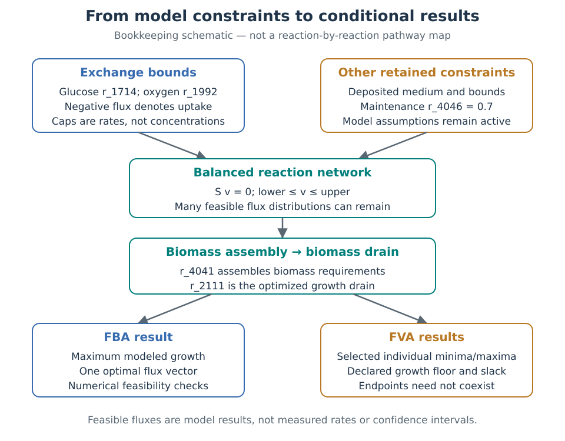

# Yeast metabolism, constraints, and what a flux range means

## A model of metabolic possibilities

*Saccharomyces cerevisiae*, the budding yeast, is a useful system for connecting cell biology with mathematical models. This workbench uses the community-maintained yeast-GEM reconstruction. Its reactions describe biochemical transformations, transport between compartments, and exchanges with the surroundings. A reconstruction collects current knowledge; it does not observe what an individual cell is doing. [Zhang et al. (2024)](https://doi.org/10.1038/s44320-024-00060-7) describe this resource and its limitations. Our pinned **v9.1.1** snapshot is a later, specific release, so its reaction, metabolite, and gene counts need not match the publication's version.

## Carbon, energy, and the meaning of growth

Glucose supplies carbon for cellular material and can support production of ATP (adenosine triphosphate), a molecule used in cellular energy transfer. Yeast central carbon metabolism includes glycolysis, the pentose phosphate pathway, and the tricarboxylic acid cycle. Carbon can also leave as carbon dioxide, ethanol, or other products. Respiration and fermentation are connected alternatives within this network; which fluxes occur depends on physiological constraints beyond reaction availability alone. [Zhang et al. (2024)](https://doi.org/10.1038/s44320-024-00060-7) and [Moreno-Paz et al. (2022)](https://doi.org/10.1111/1751-7915.13995) provide relevant biological context.

The growth objective, `r_2111`, drains the model's biomass metabolite. The upstream **biomass pseudoreaction**, `r_4041`, combines the requirements for cellular components and energy according to an assumed composition. A pseudoreaction is a bookkeeping representation of several processes, rather than one enzyme-catalyzed step. Distinguishing assembly from the drain matters when inspecting or editing the model. Maximizing the drain asks how much modeled biomass production the constraints permit; a laboratory growth rate remains a separate measurement. Changing biomass composition can change the answer even with the same nutrient bounds. The distinction between biomass bookkeeping and measured growth follows [Orth et al. (2010)](https://doi.org/10.1038/nbt.1614); the reaction IDs and stoichiometry were checked in this project's pinned model.

Cells also require energy beyond the modeled cost of making new biomass. A non-growth-associated ATP-maintenance reaction represents an aggregate demand, not a measured activity of one enzyme. In the pinned model, `r_4046` is fixed at **0.7 in the model's flux units**. Retaining that assumption makes the scenario comparison interpretable, but does not establish that every real yeast culture has the same demand. The upstream snapshot and medium are linked in [references](references.md).

## Turning reactions into a constrained problem

Figure 1 summarizes the bookkeeping described above. Its arrows connect modeling steps, not individual biochemical reactions.



**Figure 1. From declared bounds to conditional flux results.** Sources: the [pinned model and medium](../data/README.md), [scenario configuration](../scenarios.json) and [implemented formulation](methods.md). The [figure builder](../tools/build_documentation_figures.py) generates this schematic. Table 1 provides a text equivalent for its main choices.

**Table 1. What each modeling choice does—and does not establish.**

| Choice in Figure 1 | Role in this workbench | Interpretation limit |
| --- | --- | --- |
| Glucose and oxygen exchange bounds | Restrict allowed uptake rates. | A rate cap does not specify medium concentration, gas percentage or mass transfer. |
| Steady-state balances | Require modeled production and consumption to cancel. | This does not calculate metabolite concentrations or reaction kinetics. |
| Retained maintenance and medium | Keep the surrounding assumptions fixed for the comparison. | A feasible result depends on these assumptions; one altered bound is not a complete new physiological condition. |
| Biomass assembly and drain | Convert composition requirements into the growth objective. | Maximizing the drain is not a direct measurement of cell growth. |
| FVA growth floor | Restrict each minimum/maximum calculation to sufficiently high growth. | Separate endpoints need not coexist and are not statistical uncertainty bounds. |

The stoichiometric matrix, $`S`$, records which metabolites each reaction consumes or produces. Its rows distinguish modeled metabolites, including their compartments; its columns distinguish reactions. The vector $`v`$ contains reaction rates. Conventional flux balance analysis (FBA) imposes

```math
Sv=0, \qquad l\leq v\leq u,
```

then maximizes a linear objective, here biomass production. The first condition is a steady-state balance: modeled production and consumption cancel for each balanced metabolite. It does not say reactions have stopped, metabolite concentrations are zero, or the entire growing culture is unchanging. FBA does not calculate concentrations or reaction kinetics. These assumptions and distinctions follow [Orth et al. (2010)](https://doi.org/10.1038/nbt.1614).

Exchange reactions connect the network with its environment. Here negative glucose and oxygen exchange fluxes indicate uptake. An oxygen uptake cap of 1 means that the lower bound is −1; it allows uptake up to that magnitude without requiring the cap to be reached. This is a rate constraint, **not an oxygen concentration**, gas percentage, or mass-transfer setting. The glucose cap has the same distinction. The deposited [minimal_Y6 medium](https://github.com/SysBioChalmers/yeast-GEM/blob/2d594ae1c4a2d550ccef120d96a58c7bbf586255/data/conditions/minimal_Y6.yml) supplies the surrounding assumptions; changing one bound does not erase the others.

Tightening only an uptake cap shrinks the feasible set. With the same maximization objective and otherwise identical constraints, its mathematical optimum cannot increase. Conversely, relaxing oxygen uptake may leave growth unchanged when another constraint is limiting. These are properties of the optimization problem, not evidence that cells sense or respond to oxygen in a particular way.

## Why one optimal solution is not the whole answer

Different flux distributions can satisfy the same balances and achieve the same biomass objective. A solver returns one optimum, but that does not make every reaction rate in it uniquely determined. Flux variability analysis, or FVA, asks for the smallest and largest feasible value of each selected reaction while retaining the other constraints. [Kenefake et al. (2022)](https://doi.org/10.1186/s12859-022-05089-9) formalize this distinction.

Let $`z^*`$ be the best biomass objective. Before the small numerical relaxation described in the [methods](methods.md), requiring $`c^Tv\geq0.99z^*`$ keeps flux states that achieve at least 99% of that optimum. The fraction is an analyst's restriction on the feasible set, **not a 99% confidence level**. Reducing it can admit more alternatives. Each reaction's minimum and maximum come from separate optimization problems; all reported endpoints need not be achievable simultaneously. These ranges contain no sampling-based probability statement about cells.

Solver status also matters. An infeasible problem has no flux vector satisfying the declared constraints; that does not prove biological impossibility. Numerical residuals and bound violations help distinguish a well-solved model problem from an unreliable calculation. Read them alongside the biological assumptions, not as substitutes for them.

## Reading limits before biological conclusions

Standard FBA and FVA can admit internal cycles that satisfy mass balance while violating additional thermodynamic restrictions. Large conventional bounds can also determine an endpoint. A range touching such a cap deserves inspection; it is not by itself proof of a biological maximum or of a loop. [Schellenberger et al. (2011)](https://doi.org/10.1016/j.bpj.2010.12.3707) describe the loop problem and a different, loopless formulation. This workbench does not implement that formulation.

Nor does it add enzyme abundance, catalytic capacity, regulation, or dynamic extracellular balances. These can matter for yeast's respiro-fermentative behavior, as [Moreno-Paz et al. (2022)](https://doi.org/10.1111/1751-7915.13995) demonstrate in its own setting. An oxygen-bound comparison here does not validate the Crabtree effect. Setting oxygen uptake to zero alone would not validate anaerobic growth either: the upstream [anaerobic preset](https://github.com/SysBioChalmers/yeast-GEM/blob/2d594ae1c4a2d550ccef120d96a58c7bbf586255/data/conditions/anaerobic.yml) changes additional nutrient and biomass assumptions. Positive-oxygen scenarios remain a deliberately narrower question about this model's feasible states.

For definitions, see the [glossary](glossary.md); for the rationale and limits of each material choice, see the [assumptions](assumptions.md).
