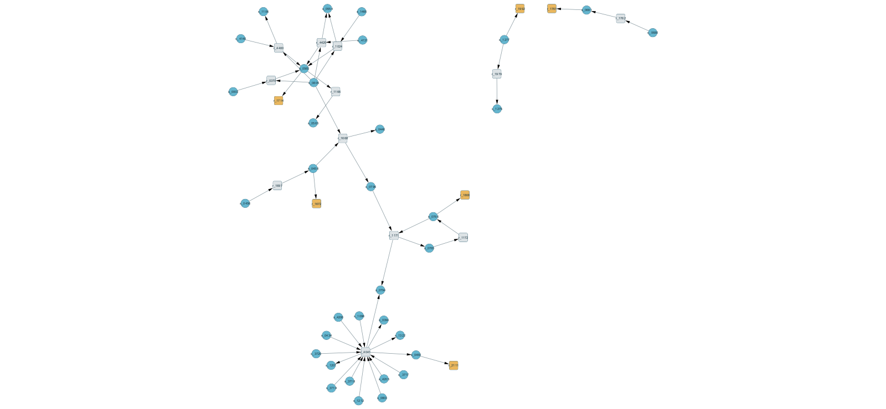

# Inspect model bookkeeping in Cytoscape

The [Cytoscape network](../examples/cytoscape/fva-neighborhood.cyjs) connects model reactions to their participating metabolites and attaches saved flux attributes. It gives readers an interoperable way to inspect identifiers, compartments, stoichiometric coefficients, and the distinction between one feasible optimum and a conditional feasible range.

The default export includes **18 reactions, 34 metabolites, and 54 stoichiometric edges**. Its selection rule is explicit: start with the six configured FVA reactions; find their metabolites; include every reaction sharing one of those metabolites; then retain every participant of the included reactions. This is a one-hop inspection neighborhood, not a complete metabolic pathway or a balanced submodel. No reaction is inferred from correlations, names, or a drawing.

## Build and open

With the repository's normal pinned dependencies:

```bash
python tools/export_cytoscape.py --out .reproduction-cytoscape
```

The exporter runs the existing source/result verifier first, including saved-vector feasibility and the alternative HiGHS algorithm. It stops on a changed source fingerprint or inconsistent saved results. The source model, its constraints, and optimization outputs are never rewritten.

In [Cytoscape](https://cytoscape.org/download.html), choose **File → Import → Network from File** and open `fva-neighborhood.cyjs`. Cytoscape supports this [Cytoscape.js JSON format](https://manual.cytoscape.org/en/3.10.0/Cytoscape.js_and_Cytoscape.html). The network contains all node/edge attributes; the companion [reaction table](../examples/cytoscape/reaction-attributes.csv) provides the same numerical attributes in a directly inspectable table. The [manifest](../examples/cytoscape/manifest.json) records exact source/output hashes and selection scope.

Use `kind` to distinguish reaction and metabolite nodes; `name` preserves the stable model identifier and `label` holds the readable name. Metabolite nodes retain their compartment. The stable IDs are namespaced as `rxn:r_…` and `met:s_…`, preventing collisions between the two node types.

The default scenario is `aerobic_reference` with a 99% growth target and the recorded numerical slack. To inspect the oxygen-limited case, use a separate output folder:

```bash
python tools/export_cytoscape.py --scenario oxygen_1 --growth-fraction 1.0 --out .reproduction-cytoscape-oxygen
```

Only configured scenarios/fractions with saved FVA are accepted. `--results-dir PATH` can select freshly reproduced optimization results.

## Check a native import

Start Cytoscape, then run this optional standard-library client against its local CyREST API:

```bash
python tools/validate_cytoscape.py --out .reproduction-cytoscape-import
```

The default port is 1234; use `--port PORT` if Cytoscape was started with another port. The client checks the export's fingerprint, imports a new network, reads every original node/edge attribute back, and renders a preview. It accepts only a new output folder, preserves existing networks, and never saves or replaces your whole session. Cytoscape replaces internal IDs with SUIDs; the check compares preserved `id_original`, `source_original`, and `target_original` attributes, then maps each actual edge endpoint through the imported node IDs to verify native topology. Regression tests reject reversed or unknown endpoints even when preserved labels match, duplicate imported identities, altered coefficients, and missing FVA values turned into zero.

The bundled [import verification](../examples/cytoscape/import-verification.json) records a successful Cytoscape 3.10.5 readback of all 52 nodes and 54 edges, with all original attributes preserved: six available FVA ranges and twelve explicitly unrequested ranges. It also fingerprints the [visual style](../examples/cytoscape/visual-style.json) and native preview. Layout coordinates may vary across runs.



**Native application preview.** Circles are metabolites; rounded squares are reactions. Gold marks the six reactions with saved FVA, gray marks reactions without requested FVA, and blue marks metabolites. Node labels retain model identifiers; inspect `label` for names and `compartment` for location. Arrows indicate forward stoichiometry. Size, position, and color do not encode flux magnitude, evidence strength, or biological proximity.

## Read the graph correctly

- An arrow follows the **forward stoichiometric direction**: reactant → reaction → product. It is not a claim that the saved net flux points that way. Negative flux reverses the net direction; inspect `fba_flux` alongside the signed `stoichiometric_coefficient`.
- `fba_flux` is one saved feasible optimum of the **full** model. A different optimal solution can use different fluxes. The six selected reactions carry `fva_minimum` and `fva_maximum`; other reaction nodes say `fva_status=not_requested` and omit the range values. Missing FVA is never encoded as zero.
- The growth drain `r_2111` uses h⁻¹; other displayed reaction fluxes use mmol gDW⁻¹ h⁻¹ under this model's conventions. Do not compare raw widths/colors across those different units.
- FVA nodes retain the requested/effective growth floor, slack and artificial-cap flag. Marginal endpoints from different reactions need not occur together and are not confidence limits.
- The drawing preserves reaction/metabolite incidence, not a pairwise metabolite clique. Metabolites outside the displayed neighborhood and omitted reactions remain part of the optimization constraints.

This visualization adds no kinetic rates, regulatory claims, dynamic behavior, or experimental validation. The model remains [yeast-GEM v9.1.1 under CC BY 4.0](../data/README.md); derived network exports retain that attribution. The exporter and verification code were written for this repository with AI assistance.
