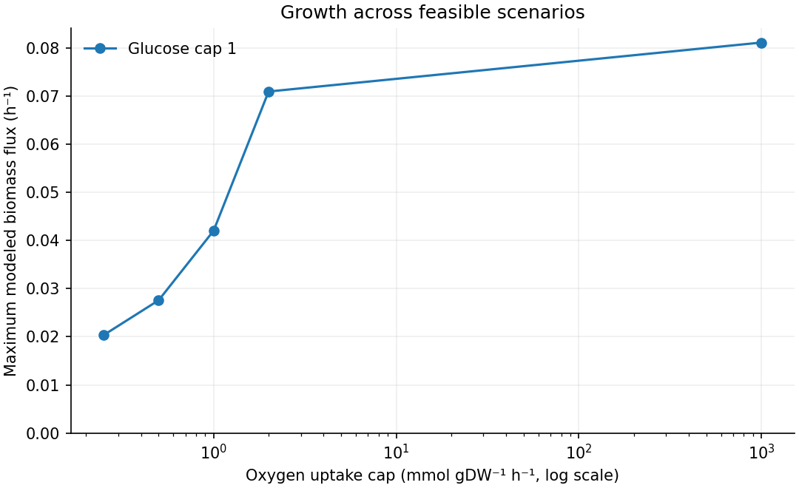
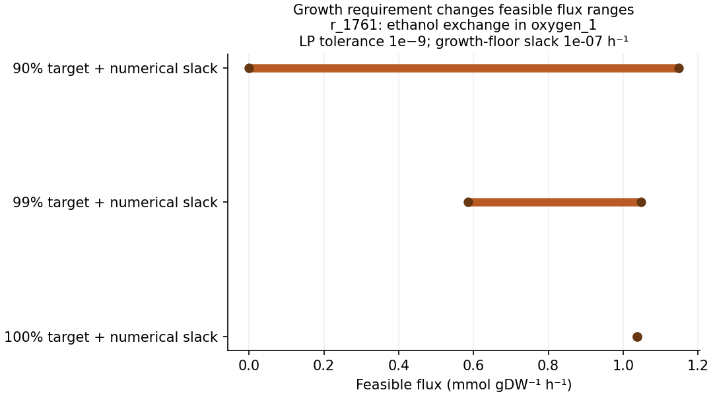

# Yeast flux constraints

The model reached a growth optimum in 5 of 6 configured scenarios.
Each cap limits uptake. The solver maximizes the biomass objective under the remaining model constraints.

| Scenario | Oxygen cap | Glucose cap | Status | Maximum biomass flux |
| --- | ---: | ---: | --- | ---: |
| aerobic_reference | 1000 | 1 | optimal | 0.081100 |
| oxygen_2 | 2 | 1 | optimal | 0.070927 |
| oxygen_1 | 1 | 1 | optimal | 0.042021 |
| oxygen_05 | 0.5 | 1 | optimal | 0.027568 |
| oxygen_025 | 0.25 | 1 | optimal | 0.020341 |
| no_glucose_diagnostic | 1000 | 0 | infeasible | — |

Exchange fluxes use mmol gDW⁻¹ h⁻¹. Growth uses h⁻¹. A negative exchange flux means uptake.

With glucose uptake set to zero, `no_glucose_diagnostic` has no feasible solution under the retained constraints. The dash in the growth column marks that outcome.

Each FVA interval gives one reaction’s feasible range at the stated growth requirement. Different endpoints can come from different flux vectors, including vectors with internal cycles.

These predictions describe steady states in the pinned yeast model. Measured growth and flux would be needed to assess agreement with yeast cultures.
